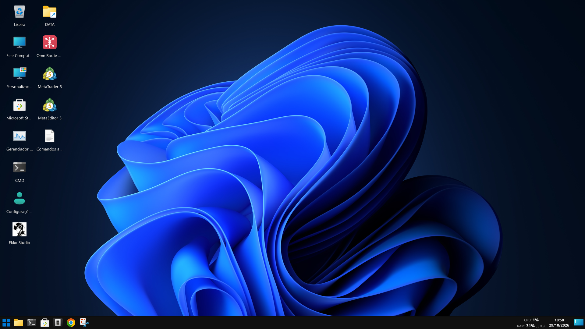
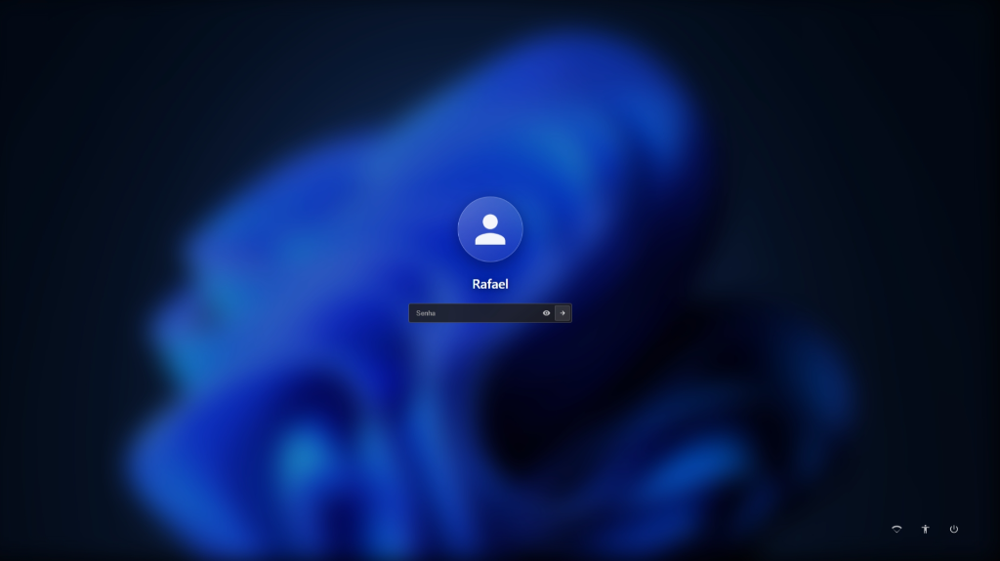
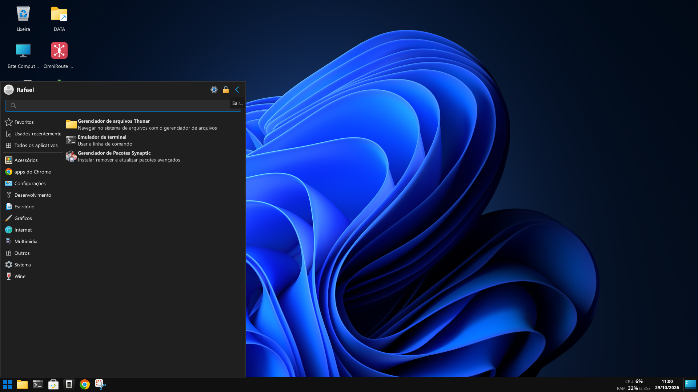
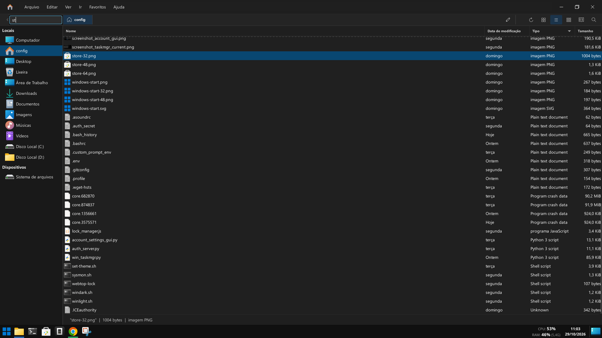
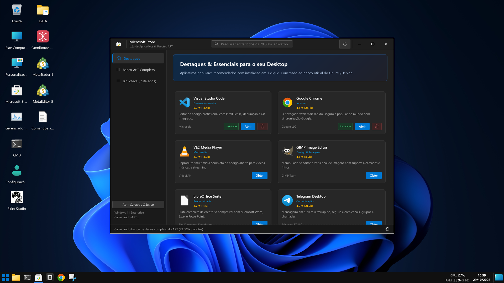
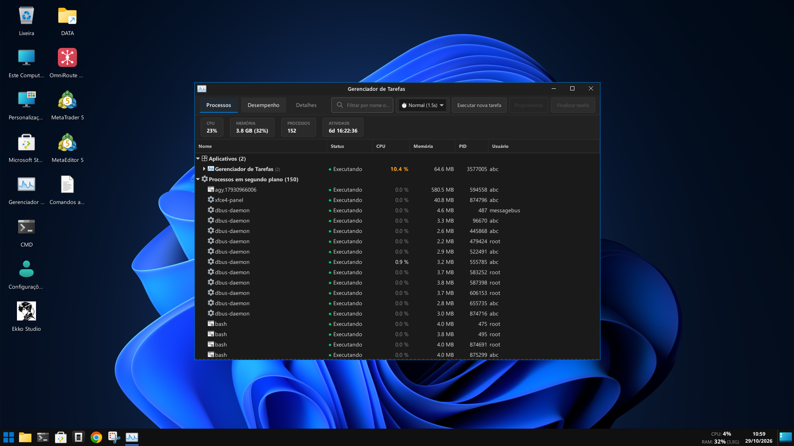

# Webtop Custom (Windows 11 Style Cloud Desktop)

🌐 **Idioma / Language:**
🇧🇷 Português (atual) &nbsp;|&nbsp;
[🇺🇸 English](README.en.md) &nbsp;|&nbsp;
[🇪🇸 Español](README.es.md) &nbsp;|&nbsp;
[🇩🇪 Deutsch](README.de.md) &nbsp;|&nbsp;
[🇫🇷 Français](README.fr.md) &nbsp;|&nbsp;
[🇮🇹 Italiano](README.it.md)

---

Uma versão customizada, leve e elegante do **Webtop** (Ubuntu XFCE) da [LinuxServer.io](https://fleet.linuxserver.io/image?name=linuxserver/webtop), transformada em um desktop moderno acessível via navegador com interface inspirada no **Windows 11**, autenticação com tela de bloqueio fluida, loja de aplicativos gráfica, gerenciador de tarefas avançado e ambiente Wine otimizado.



---

## 📸 Demonstração da Interface

### 🔒 Tela de Bloqueio & Login (Blur Acrílico)
| Tela de Bloqueio | Tela de Login |
| :---: | :---: |
|  |  |

### 🪟 Menu Iniciar & 📁 Gerenciador de Arquivos
| Menu Iniciar (Whisker Menu) | Gerenciador de Arquivos (Thunar) |
| :---: | :---: |
|  |  |

### 🛍️ Microsoft Store & 📊 Gerenciador de Tarefas
| Microsoft Store (`win-store`) | Gerenciador de Tarefas (`win_taskmgr`) |
| :---: | :---: |
|  |  |

---

## 🚀 Principais Funcionalidades

- **🪟 Interface Estilo Windows 11**:
  - Barra de tarefas centralizada (Docklike) e menu Iniciar categorizado (Whisker Menu).
  - Papel de parede oficial do Windows 11 Bloom Dark e tema escuro moderno.
- **🔒 Segurança & Autenticação Robusta**:
  - Login estilo Windows 11 com fundo em blur acrílico, relógio em tempo real e avatar do usuário.
  - Servidor de autenticação em Python (`auth_server.py`) integrado com Nginx subrequest authentication.
  - **Proteção Anti-Brute-Force**: Bloqueio automático de IP após 5 tentativas consecutivas incorretas.
  - **Rate Limiting no Nginx**: Limite de requisições por segundo contra ataques automatizados de força bruta.
  - **Proteção contra Timing Attacks**: Verificação de credenciais em tempo constante (`hmac.compare_digest`).
  - **Sessões Criptográficas**: Tokens HMAC-SHA256 com timestamp, nonce aleatório e assinatura de 256 bits.
  - Bloqueio manual por atalho (`Ctrl + Alt + L`) ou pelo botão Iniciar.
  - Bloqueio automático por inatividade configurável.
  - Painel gráfico de preferências de usuário e senha (`account-settings-gui`).
- **🌐 Acesso Direto por IP na VPS (Portas 80 / 443 Padrão)**:
  - Não requer domínio: acesse direto digitando `http://<IP-DA-VPS>` no navegador sem precisar informar porta.
- **🌍 Sistema Multilinguagem**:
  - Assistente de idioma na **primeira execução**: detecta o idioma do sistema e permite confirmar ou escolher entre 🇧🇷 PT · 🇺🇸 EN · 🇪🇸 ES · 🇩🇪 DE · 🇫🇷 FR · 🇮🇹 IT.
  - Todos os apps (Configurações, Store, Gerenciador de Tarefas) respeitam o idioma selecionado.
- **🛍️ Microsoft Store Integrada (`win-store`)**:
  - Interface gráfica amigável desenvolvida em Python/GTK3 para instalar, atualizar e remover softwares (VS Code, navegadores, utilitários, pacotes APT).
- **📊 Gerenciador de Tarefas no Estilo Windows (`win_taskmgr`)**:
  - Monitor em tempo real de uso de CPU, Memória RAM, Disco e Rede.
  - Árvore de processos com encerramento forçado e prioridades.
- **📁 Gerenciador de Arquivos Estilizado**:
  - Thunar customizado com tema Eleven-Dark, ícones modernos do Windows 11 e atalhos rápidos.
- **🍷 Suporte Otimizado a Wine**:
  - Launcher silencioso (`win-launcher`) pré-configurado com Esync/Fsync, ajuste de ptrace e dispositivo de áudio ALSA dummy para rodar executáveis Windows (`.exe`) sem travamentos ou dependências desnecessárias.
- **⚡ Alta Performance e Baixo Consumo**:
  - Serviços desnecessários desativados na inicialização (PulseAudio dummy, CUPS, AT-SPI, UDisks2).
  - Consumo mínimo de CPU e RAM em repouso.

---

## 📋 Pré-requisitos

- Docker instalado (versão 20.10+)
- Docker Compose (v2+)

---

## 🛠️ Como Iniciar

### ⚡ Opção 1 – Setup automático com SSL (RECOMENDADO)

> Roda em qualquer VPS limpa. Detecta o IP, gera o certificado **Let's Encrypt oficial** e sobe tudo em ~20 segundos.

```bash
git clone https://github.com/rmdesenvolvimentos/webtop-custom.git
cd webtop-custom
chmod +x setup.sh && sudo ./setup.sh
```

O script faz **automaticamente**:
1. 🔍 Detecta o IP público da VPS
2. 🌐 Forma o domínio `<SEU_IP>.sslip.io` (sem precisar de domínio próprio)
3. 🔒 Emite certificado **Let's Encrypt** real (cadeado verde no navegador)
4. 🐳 Sobe o container Docker com HTTPS já configurado
5. 🎉 Imprime a URL final de acesso

Resultado final:
```
✅  Desktop instalado com sucesso e 100% seguro!
🔒  Acesse agora: https://123.456.7.890.sslip.io
```

---

### 🐳 Opção 2 – Zero-Touch (só `docker compose up -d`)

Se preferir não rodar o `setup.sh`, o próprio container detecta o IP e gera o certificado SSL no primeiro boot automaticamente:

```bash
git clone https://github.com/rmdesenvolvimentos/webtop-custom.git
cd webtop-custom
docker compose up -d
```

> **Nota:** A porta 80 precisa estar livre no momento do boot para a validação do Let's Encrypt.

---

### ⚙️ Opção 3 – Configuração manual

### 1. Clonar o repositório
```bash
git clone https://github.com/rmdesenvolvimentos/webtop-custom.git
cd webtop-custom
```

### 2. Configurar as variáveis de ambiente
Copie o arquivo de exemplo `.env.example` para `.env`:
```bash
cp .env.example .env
```

Edite o arquivo `.env` para definir suas credenciais e preferências:
```ini
# Usuário e Senha de Acesso
CUSTOM_USER=Admin
PASSWORD=AltereSuaSenhaForte123!

# Portas de Acesso no Servidor (Padrão: 80 HTTP e 443 HTTPS para acesso direto por IP)
PORT_HTTP=80
PORT_HTTPS=443

# Fuso Horário e Idioma
TZ=America/Sao_Paulo
LANG=pt_BR.UTF-8
LANGUAGE=pt_BR:pt
LC_ALL=pt_BR.UTF-8

# Hostname e Título
HOSTNAME=cloud-vps
TITLE=Cloud Desktop
```

### 3. Subir o container
```bash
docker compose up -d
```

O container irá baixar a imagem base e, no primeiro boot, aplicar todas as configurações, temas, scripts e utilitários de forma 100% automática.

---

## 🌐 Como Acessar

Abra o seu navegador web e acesse:
- **Com SSL (setup.sh):** `https://<SEU_IP>.sslip.io` — cadeado verde ativo ✅
- **HTTP:** `http://IP-DA-SUA-VPS` (ou `http://localhost` se estiver rodando localmente)
- **HTTPS:** `https://IP-DA-SUA-VPS` (ou `https://localhost`)

Para destravar e entrar na área de trabalho, informe a senha configurada no arquivo `.env`.

---

## 🛡️ Camadas de Segurança Implementadas

| Camada | Mecanismo | Proteção |
| :--- | :--- | :--- |
| **Nginx Ingress** | `limit_req_zone rate=5r/s` | Mitigação de ataques DoS e scanners automatizados. |
| **Anti-Brute Force** | Lockout dinâmico por IP | Bloqueio temporário após 5 senhas incorretas com delay intencional. |
| **Timing Attacks** | `hmac.compare_digest` | Verificação de hash em tempo constante impedindo enumeração de timing. |
| **Integridade de Sessão** | HMAC-SHA256 Token | Cookies com flags `HttpOnly`, `SameSite=Lax` e chave privada de 256 bits. |
| **Privilégios Administrativos** | Sessão Autenticada | Endpoints sensíveis exigem token válido ativo. |
| **Headers HTTP** | Security Headers | `X-Content-Type-Options: nosniff`, `X-Frame-Options: SAMEORIGIN`. |

---

## 📁 Estrutura do Repositório

```text
webtop-custom/
├── .env.example              # Exemplo de configuração de variáveis de ambiente
├── .gitignore                # Regras de exclusão do Git (ignora dados, caches e credenciais)
├── LICENSE                   # Licença MIT
├── README.md                 # Documentação do projeto
├── docker-compose.yml        # Definição do serviço Docker (portas padrão 80 e 443)
├── docs/
│   └── screenshots/          # Capturas de tela demonstrativas
├── custom-cont-init.d/       # Scripts de inicialização executados pelo s6-overlay
│   ├── 00-first-boot.sh      # Inicializa e descompacta os temas e configs no primeiro boot
│   ├── 00-hostname.sh        # Configura hostname e resolução local
│   ├── 01-optimize.sh        # Otimiza o sistema desativando serviços pesados
│   ├── 10-install-apps.sh    # Instala utilitários essenciais (VS Code, Docklike, etc.)
│   ├── 20-auth-setup.sh      # Configura Nginx seguro, daemon de autenticação e bloqueio
│   └── 30-wine-setup.sh      # Ajustes de desempenho para execução de programas Windows
└── config-template/          # Arquivos de modelo clonados para o volume do usuário
    ├── account_settings_gui.py
    ├── auth_server.py
    ├── lock_manager.js
    ├── login_assets/
    │   ├── login.html
    │   └── wallpaper.jpg
    ├── nginx-default.conf
    ├── store-64.png
    ├── win-store.py
    ├── win_taskmgr.py
    └── win11-theme-pack.tar.gz
```

---

## ⌨️ Atalhos Úteis

- **Bloquear tela:** `Ctrl + Alt + L`
- **Gerenciador de Tarefas:** `Ctrl + Shift + Esc` (ou atalho no menu Iniciar)
- **Loja de Aplicativos:** Atalho na barra de tarefas ou menu Iniciar

---

## 📄 Licença

Este projeto está licenciado sob a Licença MIT - consulte o arquivo [LICENSE](LICENSE) para obter mais detalhes.
